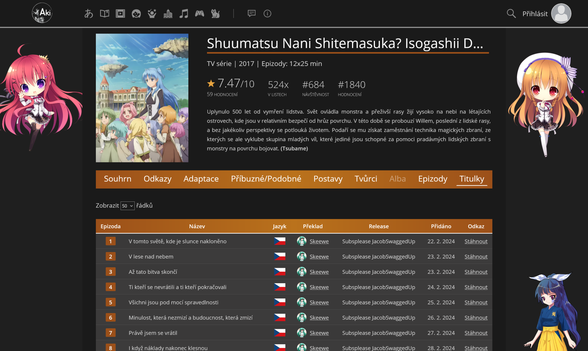

# AkiYori

Userscript, který na [Akichan.moe](https://akichan.moe/) přidá k anime záložku **Titulky**. Titulky se načítají z [Hiyori](https://hiyori.cz/) přes jejich API.

Tabulka obsahuje epizodu, název, jazyk, fansub/překladatele, release a datum přidání. Titulky jde rovnou stáhnout, nebo přejít na odkaz, kde jsou zveřejněné.

## Co potřebuješ

- Rozšíření pro userscripty: [Tampermonkey](https://www.tampermonkey.net/), [Greasemonkey](https://www.greasespot.net/) nebo [Violentmonkey](https://violentmonkey.github.io/).
- Účet na [hiyori.cz](https://hiyori.cz/) a **Hiyori API klíč** s oprávněními `subtitles.read` a `subtitles.download`.

## Instalace

1. Nainstaluj Tampermonkey, Greasemonkey nebo Violentmonkey.
2. Otevři [tento odkaz](https://raw.githubusercontent.com/Anonrika/AkiYori/main/aki-yori.user.js). Rozšíření ti nabídne instalaci.
3. Potvrď instalaci. Aktualizace pak rozšíření stahuje samo.

## Nastavení API klíče

Bez API klíče se titulky nenačtou. Aki-chan tě na to upozorní.

1. Požádej na Hiyori o API klíč s oprávněními `subtitles.read` a `subtitles.download`.
2. Otevři anime na Akichan.
3. Klikni na ikonu rozšíření a v nabídce skriptu vyber **Nastavit Hiyori API klíč**.
4. Vlož klíč a obnov stránku.

Klíč se ukládá jen v úložišti rozšíření a posílá se jen na `api.hiyori.cz`.

Klíč platí **3 měsíce**. Až vyprší, Aki-chan ohlásí odmítnutý přístup. Pak si vyžádej nový klíč a nastav ho stejným postupem.

## Použití

Otevři na Akichan stránku anime a přepni se na záložku **Titulky**. Odkaz končící `/titulky` otevře záložku rovnou.

Skript páruje anime podle odkazu na MyAnimeList. Když stránka anime odkaz na MAL nemá, záložka se nezobrazí.

## Problémy

| Hláška | Co s tím |
| --- | --- |
| Nemáš nastavený klíč na Hiyori API | Nastav klíč podle návodu výše. |
| Hiyori odmítla přístup k API | Klíč je chybný, propadlý (platí 3 měsíce) nebo nemá oprávnění `subtitles.read` / `subtitles.download`. Vyžádej si nový a nastav ho znovu. |
| Máš vyčerpaný limit volání na Hiyori | API má limit požadavků. Počkej chvíli a zkus to znovu. |

Další chyby najdeš v konzoli prohlížeče.

## Jak to funguje

1. Skript vymění API klíč za token (`POST /v2/login/token`) a uloží ho na dobu session. Když token vyprší, vyžádá si nový.
2. Z odkazu na MyAnimeList zjistí MAL ID anime a načítá titulky po stránkách (`GET /v2/subtitles/anime/mal/{id}`).
3. Tabulku vykreslí pomocí DataTables, které už Akichan na stránce používá. Vzhled tak odpovídá zbytku webu.
4. Stažení jde přes `GET /v2/subtitles/{id}/download`.
